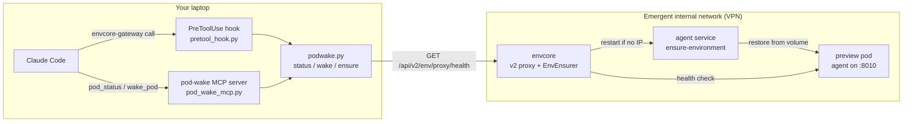
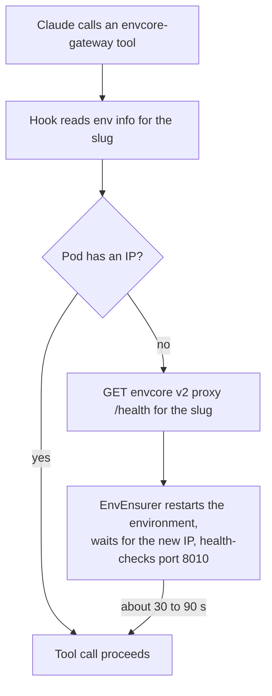
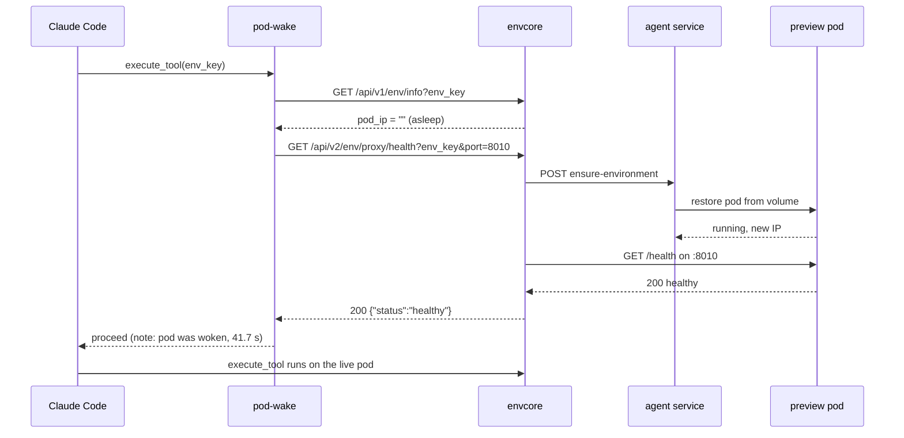
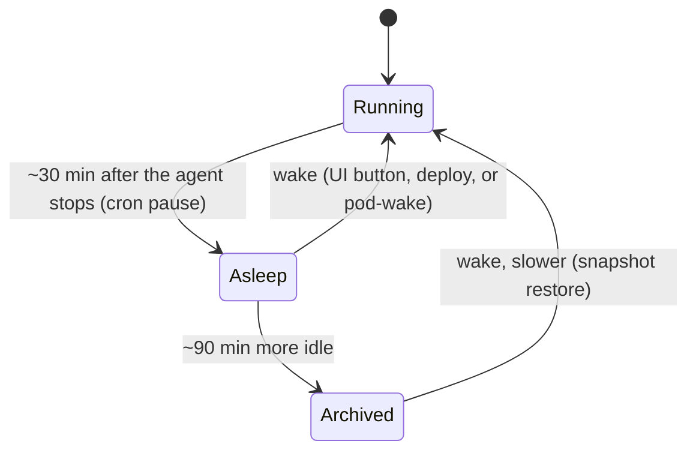

# pod-wake

**Keep Emergent preview pods awake while Claude Code works on them.**

A small, dependency-free toolkit for Emergent support engineers: a CLI, an MCP server that gives Claude two tools (`pod_status`, `wake_pod`), and a Claude Code hook that wakes a sleeping preview pod automatically before any envcore-gateway command runs.

---

## Why

Emergent preview pods are paused by a cron job about 30 minutes after the customer's agent stops. Only agent activity counts as "active": edits made through envcore and traffic to the preview URL do not. So a pod you are fixing on a ticket is on a 30-minute fuse, and when it goes, every envcore-gateway call fails with:

```
failed to resolve env_key "<slug>": empty IP
```

Until now the fix was manual: open the app in the Emergent UI, press wake, wait, retry. pod-wake removes that loop.

## Architecture



## How a wake happens



envcore exposes two proxy routes. The v1 route and the MCP gateway do a plain lookup and stop on an empty IP. The v2 route is wired to envcore's EnvEnsurer, which restores the pod from its kept volume, polls for the new IP, health-checks the pod agent, and only then forwards the request. pod-wake sends one GET to that route and waits for the healthy answer. The route is internal and reachable only on the Emergent VPN.



Measured on a real sleeping pod: asleep to healthy with a new IP in 41.7 seconds, one attempt.

## Pod lifecycle, for context



## What is in the box

| File | Purpose |
| --- | --- |
| `podwake.py` | CLI and library. Standard library only. `status`, `wake`, `ensure`. |
| `pod_wake_mcp.py` | Stdio MCP server exposing `pod_status(env_key)` and `wake_pod(env_key, timeout_sec)`. |
| `pretool_hook.py` / `pretool_hook.sh` | Claude Code PreToolUse hook for envcore-gateway execute and browser tools. |
| `install.sh` | macOS/Linux installer: registers the MCP server and merges the hook into `~/.claude/settings.json` (backup kept). |
| `install.ps1` | Windows installer: same steps in PowerShell, hook wired to Python directly. |
| `settings.example.json` | The hook snippet, if you prefer to merge it by hand. |

`env_key` accepts the app slug (the part before `.preview.emergentagent.com`), the pod name, or the full preview URL.

## Requirements

- [Claude Code](https://claude.com/claude-code) on macOS, Linux or Windows
- [`uv`](https://docs.astral.sh/uv/) on your `PATH` (runs the MCP server with its one dependency)
- Python 3.10 or newer (`python3` on macOS/Linux, `python` or the `py` launcher on Windows)
- Emergent VPN connected

Everything is plain Python, so the CLI, the MCP server and the hook run on all three platforms. The installers differ: `install.sh` for macOS/Linux, `install.ps1` for Windows.

## Install

**macOS / Linux**

```bash
git clone https://github.com/yash-emergent/pod-wake.git ~/mcp-servers/pod-wake
~/mcp-servers/pod-wake/install.sh
```

**Windows (PowerShell)**

```powershell
git clone https://github.com/yash-emergent/pod-wake.git $HOME\mcp-servers\pod-wake
powershell -ExecutionPolicy Bypass -File $HOME\mcp-servers\pod-wake\install.ps1
```

On Windows the hook is wired to Python directly (no shell wrapper), so Git Bash is not required. Run `podwake.py` as `python podwake.py status <slug>`.

The script registers the `pod-wake` MCP server in your user scope, backs up `~/.claude/settings.json`, and merges in the hook. Then **start a new Claude Code session**: MCP servers and hooks load at session start. `/mcp` should list `pod-wake` with two tools.

Prefer to do it by hand? Register the server and merge `settings.example.json` into your settings (on Windows point the hook `command` at `python.exe` with `args: ["<path>\\pretool_hook.py"]` instead of the `.sh` wrapper):

```bash
claude mcp add --scope user pod-wake -- "$(which uv)" run --script ~/mcp-servers/pod-wake/pod_wake_mcp.py
```

Optional, so Claude uses it unprompted. Add to `~/.claude/CLAUDE.md`:

> If a preview pod is asleep or envcore-gateway returns "empty IP", run pod-wake `wake_pod` instead of asking me to wake it in the UI.

## Usage

**In Claude Code**

```
pod_status for my-app-42
wake_pod my-app-42
```

**From the terminal**

```bash
~/mcp-servers/pod-wake/podwake.py status my-app-42
~/mcp-servers/pod-wake/podwake.py wake   my-app-42 --timeout 180
~/mcp-servers/pod-wake/podwake.py ensure my-app-42     # wake only if asleep or unhealthy
```

Every command prints JSON. Example wake result:

```json
{
  "env_key": "my-app-42",
  "preview_url": "https://my-app-42.preview.emergentagent.com",
  "before": "asleep",
  "ok": true,
  "action": "woken",
  "pod_ip": "10.103.4.180",
  "attempts": 1,
  "seconds": 41.7
}
```

**The hook** needs nothing from you. Before each envcore-gateway execute or browser call it checks the pod, wakes it if needed, and lets the call proceed. It is silent when the pod is awake, adds a one-line note to Claude's context when it woke the pod, and never blocks a call if the wake fails.

## Testing on your laptop

Use your own test app, not a customer's.

1. **Status on a running pod.** `pod_status <slug>` returns `state: running` and a `pod_ip`.
2. **Wake a sleeping pod.** Pick an app idle for 30+ minutes, confirm `state: asleep`, then `wake_pod <slug>`. Expect `action: woken`, a new `pod_ip`, and 30 to 90 seconds. Open the preview URL to confirm.
3. **Automatic wake.** With the pod asleep again, ask Claude to run any envcore-gateway command on it, for example `execute_bash` with `echo hi`. It should succeed first try, with the hook's note that the pod was woken.

`state: unreachable` with a VPN hint means the VPN is off. `not_found` means envcore does not know the slug.

## Limits and safety

- **Restores only.** The tool never reads, edits or deletes app files or data. It uses the same restore path as the deploy pipeline and the customer's own wake button.
- **VPN required.** Off VPN every call returns `unreachable`.
- **10-minute cooldown.** envcore refuses a second restart of the same environment within 10 minutes. Wait and retry.
- **Windows is untested so far.** The code is portable, but the first Windows install should report back (see Contributing).
- **Archived pods restore slower.** After about 90 minutes asleep the volume is archived. Pass `timeout_sec: 300` or wake twice.
- **Failed backups cannot be woken.** If the pod's backup failed, no wake path restores it. Use the UI or escalate.
- **Agent-only jobs have no pod.** Wingman, moltbot and brainstorm jobs cannot be woken.
- **Each wake costs compute.** A woken pod runs for at least 30 minutes. The hook fires only on real commands, never on tool discovery.
- **In-memory state resets.** A wake creates a new pod. Files and the database persist.

## Configuration

| Variable | Default | Meaning |
| --- | --- | --- |
| `ENVCORE_BASE_URL` | internal envcore host | Override for dev or canary environments |
| `ENVCORE_POD_PORT` | `8010` | Pod agent port used for the health check |
| `POD_WAKE_TIMEOUT` | `180` | Default wake timeout in seconds |

## Contributing

Issues and pull requests are welcome. Keep `podwake.py` free of third-party dependencies so the hook stays fast and portable. Run the three tests above against your own test app before opening a PR.

## License

[MIT](LICENSE)
