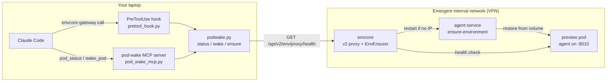
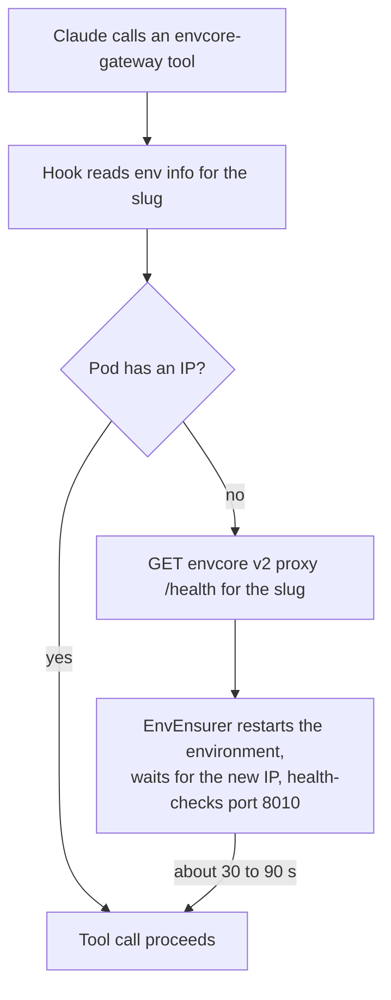
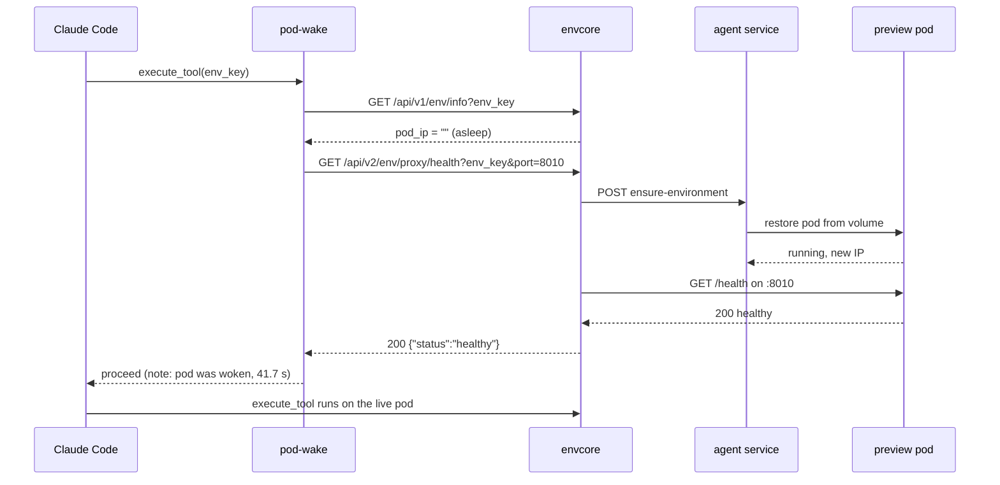
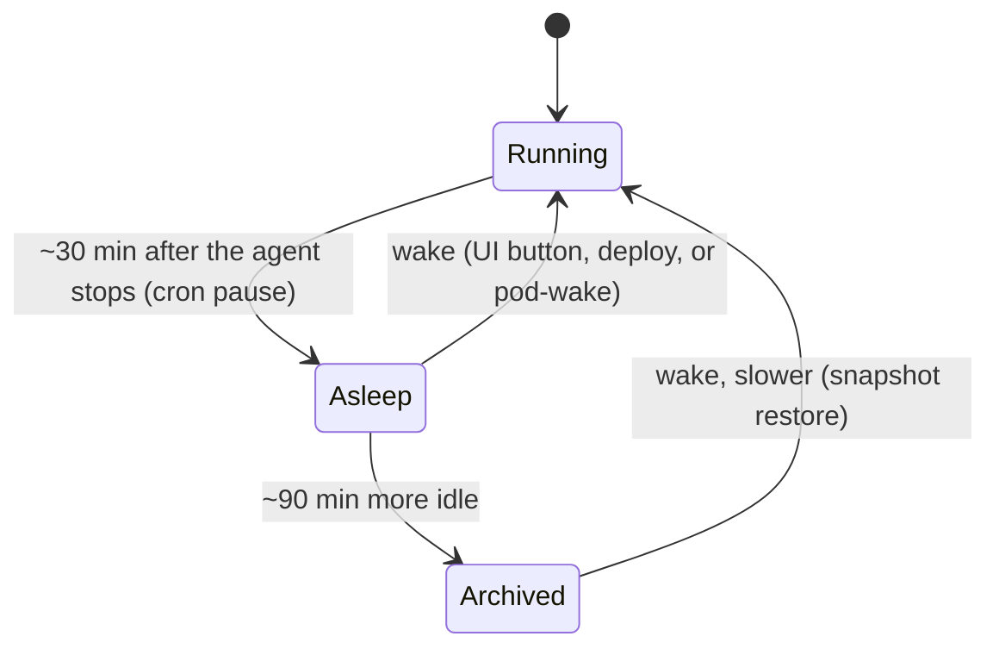

# pod-wake

**Stop babysitting sleeping preview pods. Let Claude wake them.**

pod-wake is a small Claude Code add-on for Emergent support work. It gives Claude two tools, `pod_status` and `wake_pod`, plus a hook that quietly wakes a sleeping preview pod before any envcore-gateway command runs. No more "go to the customer's job, press wake, come back, tell Claude to continue".

It is a small tool, but it saves you a few minutes every time a pod falls asleep mid-ticket, and that adds up.

> **v1, built by Yashwanth.** It works on the cases below, but it has not seen every pod and every laptop yet. If something breaks or looks odd, message me on Slack ([**@yashwanth**](https://emergentlabsinc.slack.com/team/U0BEBR4TE7R)) with the slug and the exact tool output, and it will get fixed.

---

## When it helps

**1. Mid-fix, the pod falls asleep.** You are fixing a customer's app through Claude. Thirty minutes after the customer's agent stopped, the cron pauses the pod. If you happen to be watching, you spot Claude's "empty IP" error, go to the user's job, press wake, wait, and tell Claude to continue. If you are not watching, the process just halts. With pod-wake the hook sees the sleeping pod, wakes it, and the command runs. No interruption, no manual step.

**2. Starting on a ticket.** You read the ticket and want to poke at the pod or make a change. Instead of opening the user's job first to wake the server, just tell Claude what to do. Claude checks the pod, wakes it if needed, and gets on with it.

**3. No admin access during an incident.** During a recent SOS most of us did not have admin access, so we could not open a user's job from the job ID to wake their server. pod-wake needs only the app slug and the VPN. Claude can wake the pod and work on it through envcore-gateway without the admin console.

## Why pods sleep in the first place

Preview pods are paused by a cron job about 30 minutes after the customer's agent stops. Only agent activity counts: edits made through envcore and visits to the preview URL do not reset the timer. So a pod you are working on is always on a 30 minute fuse, and when it goes, every envcore-gateway call fails with:

```
failed to resolve env_key "<slug>": empty IP
```

## How it works



envcore has two proxy routes. The v1 route and the MCP gateway do a plain lookup and give up on an empty IP. The v2 route is wired to envcore's EnvEnsurer, which restores the pod from its kept volume, waits for the new IP, health-checks the pod agent on port 8010, and only then forwards the request. pod-wake sends one GET to that route and waits for the healthy answer. The route is internal and reachable only on the Emergent VPN.





Measured on a real sleeping pod: asleep to healthy with a new IP in 41.7 seconds, one attempt.



## What is in the box

| File | What it does |
| --- | --- |
| `podwake.py` | CLI and library. Standard library only. `status`, `wake`, `ensure`. |
| `pod_wake_mcp.py` | Stdio MCP server exposing `pod_status(env_key)` and `wake_pod(env_key, timeout_sec)`. |
| `pretool_hook.py` / `pretool_hook.sh` | Claude Code PreToolUse hook for envcore-gateway execute and browser tools. |
| `install.sh` | macOS/Linux installer: registers the MCP server, merges the hook into `~/.claude/settings.json` (backup kept). |
| `install.ps1` | Windows installer: same steps in PowerShell, hook wired to Python directly. |
| `settings.example.json` | The hook snippet, if you prefer to merge it by hand. |
| `CLAUDE_PROMPT.md` | The prompt you paste into Claude once so it uses the tool on its own. |

`env_key` accepts the app slug (the part before `.preview.emergentagent.com`), the pod name, or the full preview URL.

## Requirements

- [Claude Code](https://claude.com/claude-code) on macOS, Linux or Windows
- [`uv`](https://docs.astral.sh/uv/) on your `PATH` (runs the MCP server with its one dependency)
- Python 3.10 or newer (`python3` on macOS/Linux, `python` or the `py` launcher on Windows)
- Emergent VPN connected

Everything is plain Python, so the CLI, the MCP server and the hook run on all three platforms. Only the installer differs.

## Install, step by step

### 1. Get the code

**macOS / Linux**

```bash
git clone https://github.com/yash-emergent/pod-wake.git ~/mcp-servers/pod-wake
~/mcp-servers/pod-wake/install.sh
```

**Windows (PowerShell)**

```powershell
git clone https://github.com/yash-emergent/pod-wake.git $HOME\mcp-servers\pod-wake
powershell -ExecutionPolicy Bypass -File $HOME\mcp-servers\pod-wake\install.ps1
```

The installer registers the `pod-wake` MCP server in your user scope, backs up `~/.claude/settings.json`, and merges in the hook. It is safe to re-run.

Prefer to do it by hand? Register the server and merge `settings.example.json` into your settings (on Windows point the hook `command` at `python.exe` with `args: ["<path>\\pretool_hook.py"]` instead of the `.sh` wrapper):

```bash
claude mcp add --scope user pod-wake -- "$(which uv)" run --script ~/mcp-servers/pod-wake/pod_wake_mcp.py
```

### 2. Start a new Claude Code session

MCP servers and hooks load at session start, so an already open session will not see them. Open a fresh one and run `/mcp`. You should see `pod-wake` with two tools.

### 3. Tell Claude to use it on its own (one time)

Paste this into Claude in that new session. It makes Claude wake pods by itself from now on, so you never have to say "use pod-wake" again. Also in [`CLAUDE_PROMPT.md`](CLAUDE_PROMPT.md).

```
You now have a tool called pod-wake. It gives you two MCP tools: pod_status(env_key) and wake_pod(env_key).

Context: Emergent preview pods go to sleep about 30 minutes after the customer's agent stops. When a pod is asleep, every envcore-gateway call fails with: failed to resolve env_key "<slug>": empty IP. The env_key is the app slug (the part before .preview.emergentagent.com), the pod name, or the preview URL.

From now on, whenever a preview pod is asleep, or an envcore-gateway call fails with "empty IP", do not ask me to wake it from the Emergent UI. Instead:
1. Run pod_status on the slug to confirm it is asleep.
2. Run wake_pod on the slug and wait for it to report action: woken (usually 30 to 90 seconds).
3. Continue exactly what you were doing before.

Also, when I give you a ticket or a slug and ask you to investigate or change something on the preview pod, check pod_status first and wake it if needed before running commands.

If wake_pod times out, or returns not_found or unreachable, show me the exact output and stop. Do not retry more than twice; envcore has a 10 minute cooldown between restarts.

Please save this as a permanent memory so it applies in every future session.
```

Prefer a one-liner? Add this to your `~/.claude/CLAUDE.md`:

> If a preview pod is asleep or envcore-gateway returns "empty IP", run pod-wake `wake_pod` on the slug and continue. Do not ask me to wake it in the UI.

### 4. Try it

Use one of your own test apps, not a customer's.

1. **Status on a running pod.** Ask Claude: `pod_status for <slug>`. Expect `state: running` and a `pod_ip`.
2. **Wake a sleeping pod.** Pick a test app idle for 30+ minutes, confirm `state: asleep`, then `wake_pod <slug>`. Expect `action: woken`, a new `pod_ip`, and 30 to 90 seconds. Open the preview URL to confirm.
3. **Automatic wake.** With the pod asleep again, ask Claude to run any envcore-gateway command on it, for example `execute_bash` with `echo hi`. It should succeed first try, with the hook's note that the pod was woken.

`state: unreachable` with a VPN hint means the VPN is off. `not_found` means envcore does not know the slug.

## Using it day to day

**In Claude Code** (after step 3 you mostly will not need to):

```
pod_status for my-app-42
wake_pod my-app-42
```

**From the terminal**

```bash
~/mcp-servers/pod-wake/podwake.py status my-app-42
~/mcp-servers/pod-wake/podwake.py wake   my-app-42 --timeout 180
~/mcp-servers/pod-wake/podwake.py ensure my-app-42     # wake only if asleep or unhealthy
```

(On Windows: `python podwake.py status my-app-42`.) Every command prints JSON. Example wake result:

```json
{
  "env_key": "my-app-42",
  "preview_url": "https://my-app-42.preview.emergentagent.com",
  "before": "asleep",
  "ok": true,
  "action": "woken",
  "pod_ip": "10.103.4.180",
  "attempts": 1,
  "seconds": 41.7
}
```

**The hook** needs nothing from you. Before each envcore-gateway execute or browser call it checks the pod, wakes it if needed, and lets the call proceed. Silent when the pod is awake, one line in Claude's context when it woke the pod, and it never blocks a call if the wake fails.

## Good to know

- **Restores only.** The tool never reads, edits or deletes app files or data. It uses the same restore path as the deploy pipeline and the customer's own wake button.
- **VPN required.** Off VPN every call returns `unreachable`.
- **10 minute cooldown.** envcore refuses a second restart of the same environment within 10 minutes. Wait and retry.
- **Archived pods restore slower.** After about 90 minutes asleep the volume is archived. Pass `timeout_sec: 300` or wake twice.
- **Failed backups cannot be woken.** If the pod's backup failed, no wake path restores it. Use the UI or escalate.
- **Agent-only jobs have no pod.** Wingman, moltbot and brainstorm jobs cannot be woken.
- **Each wake costs compute.** A woken pod runs for at least 30 minutes. The hook fires only on real commands, never on tool discovery.
- **In-memory state resets.** A wake creates a new pod. Files and the database persist.
- **Windows is untested so far.** The code is portable, but the first Windows install should report back.

## Configuration

| Variable | Default | Meaning |
| --- | --- | --- |
| `ENVCORE_BASE_URL` | internal envcore host | Override for dev or canary environments |
| `ENVCORE_POD_PORT` | `8010` | Pod agent port used for the health check |
| `POD_WAKE_TIMEOUT` | `180` | Default wake timeout in seconds |

## Found a problem? Have an idea?

This is v1. Message me on Slack ([**@yashwanth**](https://emergentlabsinc.slack.com/team/U0BEBR4TE7R)) with the slug, what you asked Claude to do, and the exact tool output, or open an issue here. Pull requests are welcome too; keep `podwake.py` free of third-party dependencies so the hook stays fast, and run the three checks in step 4 against your own test app first.

## License

[MIT](LICENSE)
